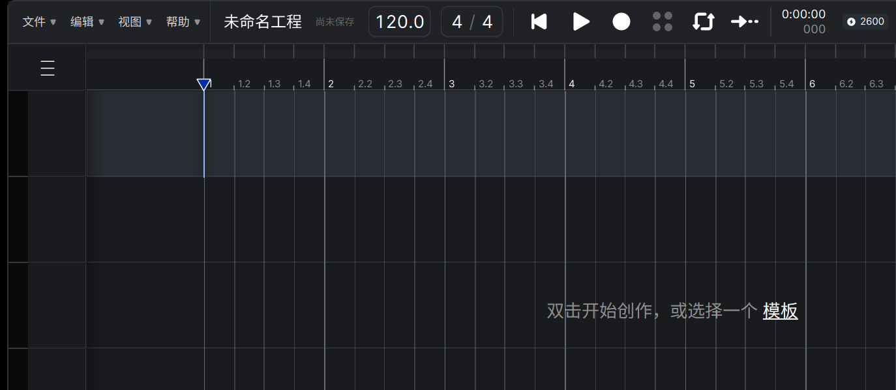

# 视频素材（封面图 + IndexTTS 音色参考）

---

## 一、封面底图

### A. 本机实拍（推荐，无版权问题、无水印）



- 文件：`docs/cover/ace-studio.png` · **1374×599** · PNG
- 来源：直接从你正在跑的 ACE Studio 窗口抓的（PrintWindow，含真实中文 UI）
- 特点：深色编辑器 + 网格 + 顶部工具栏，**右下留白大**，适合压标题；
- 建议：如果想更有内容，把工程打开（有轨道/音符/侧栏）后我再抓一张，画面会比空工程更有说服力。

### B. 网图候选（要压字前先看水印/授权）

| 文件 | 尺寸 | 画面 | 注意 |
|---|---|---|---|
| `docs/cover/ace-laptop.png` | 1270×760 | 笔记本里跑 ACE，暗背景 + 顶部大英文标题 | 顶部原文案与你的标题会打架，需要遮住；来源：allhereai |
| `docs/cover/ace-voices.png` | 1200×675 | 声线卡片墙（14 位 AI 歌手） | 右下有“AI工具集”水印；来源：ai.techsir |
| `docs/cover/ace-hero.png` | 1200×675 | 官方风 hero：显示器 + “AI歌声合成工作站” | 右下同款水印；来源：ai.techsir |

- 来源页：[allhereai · ACE Studio 2.0](https://www.allhereai.com/products/ace_studio_2_0)、[ai.techsir](https://ai.techsir.com/sites/1795.html)
- ⚠️ 这三张是第三方站点的宣传截图，**商用前确认授权**；A 是自家屏幕截图，风险最低。

### 压字建议（1366×768 或 1920×1080 画布）

- 底图放满 + 40% 黑色遮罩（`#000` 40%），字才压得住；
- 主标题 72–96pt 粗体（思源黑体 Heavy / 阿里巴巴普惠体 Bold），副标题 36–40pt 常规；
- 标题放**左下或右下**（A 图右侧留白最大），别压在工具栏和网格线上；
- 主色取 ACE 界面里的蓝紫（约 `#6C5CE7` / `#4A90E2`），与底图同源。

---

## 二、IndexTTS 音色参考片段

### 先说结论

IndexTTS 的参考音频（prompt）要求：**单人、干净、无音乐/混响、5–15 秒**、16k/24k 单声道 wav。所以最合适的是**你自己按下面稿子录 10–15 秒**——音色、口音、语速都能直接决定成品效果。

### 录制稿（选一段，10–15 秒）

**A. 产品讲解型（推荐，贴合你的演示视频）**

> 这是一个贴在 ACE Studio 边上的小工具。双击就能跑，不弹黑框，也不抢焦点。它会把改歌词、搬参数、复制音高线这些重复活，变成一次点击。

**B. 平实叙述型（更中性，适合做通用音色）**

> 今天我们来聊聊音频编辑。很多人以为，调整一条曲线的形状，需要反复地听、反复地改。其实只要把源和目标对齐，这件事可以很快完成。

**C. 情绪稍强型（想让合成声音更有起伏时用）**

> 我一开始也不信，一条包络曲线，居然能决定整段人声听起来是紧还是松。直到我把它搬到另一条轨上，才发现差别有多大。

### 录音规范（照这个录，IndexTTS 出片最稳）

| 项目 | 要求 |
|---|---|
| 时长 | 10–15 秒（最短别低于 5 秒） |
| 采样率 | 24000 Hz（或 16000） |
| 声道 | 单声道 |
| 格式 | WAV（PCM 16bit） |
| 环境 | 安静房间，关空调/风扇；离麦 15–20cm，略偏轴避免喷麦 |
| 内容 | 一句话连贯读完，**不要**中途清嗓、停顿超过 1 秒 |
| 情绪 | 与视频整体一致（讲解型就平稳、别太亢奋） |
| 处理 | **不要**加降噪/压缩/混响；音量峰值 −6 dB 左右即可 |

命令行转成标准格式（有 ffmpeg 时）：

```powershell
ffmpeg -i 录音.m4a -ac 1 -ar 24000 -c:a pcm_s16le ref_24k.wav
```

### 如果不想自己录，可用的公有领域来源

| 来源 | 授权 | 适配度 |
|---|---|---|
| [Mozilla Common Voice 中文（CC0）](https://mozilladatacollective.com/datasets/cmu5lcunh00qimh078sdd5so8) | CC0，可商用 | 短句 5–8 秒、口音多样，**多数带环境噪**，要挑安静的片段 |
| [LibriVox 中文有声书（公有领域）](https://librivox.org/) | 公有领域 | 朗读腔、语速稳，适合“解说”音色；单段较长，需自己裁 10–15 秒 |
| 自己录（上面 A/B/C） | 自有 | ★ 最推荐：音色、语气完全可控 |

> ⚠️ 别用带背景音乐、多人对话、或明显后期处理的片段——IndexTTS 会把音乐/混响一起“学”进去。

### 我可以继续帮你做的

- 你把录音丢进 `docs/cover/`，我用 ffmpeg 帮你切成 10–15 秒、转 24k 单声道、并做响度检查；
- 或者告诉我想要的声音气质（低沉男声 / 清亮女声 / 播客感），我按这个把上面稿子再改一版。

---

## 一·补充：ACE logo + 工程截图（你要的“可扣”素材）

### 1. Logo（已抠成透明，直接可用）

| 文件 | 尺寸 | 说明 |
|---|---|---|
| `docs/cover/ace-logo-icon-transparent.png` | 480×480 | **app 图标**（紫色 a + 白色 c/e），深色底已抠掉，透明背景 |
| `docs/cover/ace-logo-wordmark-transparent.png` | 840×224 | **横版标**（图标 + “ACE Studio”），透明背景，压封面首选 |
| `docs/cover/ace-logo-icon.png` / `-256.png` | 480 / 256 | 原版（带深色底，未抠） |

- 透明版是用亮度阈值抠的：白色字/紫色块保留，圆角边缘有半透明过渡（放到深色底上看不出来）；
- 如果放到浅色底上边缘会有一点灰边 ⇒ 用 PS 的“选择主体”再收 1px 更干净。

### 2. 工程截图（带 logo 的现成图，你可以扣、也可以直接用）

| 文件 | 尺寸 | 画面 |
|---|---|---|
| `docs/cover/ace-project-allhere.png` | 1270×760 | **左上角带 ACE Studio 完整标**，右侧是黄色音符的钢琴卷帘窗，深色纹理底 —— 你要的“带 logo 的背景”就是它 |
| `docs/cover/ace-project-zdm.jpg` | 1080×608 | 多轨编曲 + 钢琴卷帘拼图（ACE 2.0 功能页），信息量大、有点花 |
| `docs/cover/ace-studio.png` | 1374×599 | 你自己 ACE 窗口实拍（空工程、无水印），做干净底图最稳 |

- 前两张来源：[allhereai · ACE Studio 2.0](https://www.allhereai.com/products/ace_studio_2_0)、[什么值得买 · ACE Studio 2.0 功能全解](https://post.smzdm.com/p/a65r8xko/)（商用前确认授权）；
- 第三张是自家截图，无版权问题。

### 3. 推荐组合

- 底图：`ace-project-allhere.png`（或你自己的工程截图）；
- 左上/右下压 `ace-logo-wordmark-transparent.png`（高 36–48px），标题用思源黑体 Heavy；
- 若嫌 allhere 那张里“AI INSTRUMENT”字太大 ⇒ 裁掉下半部分，只留“logo + 钢琴卷帘窗”。
